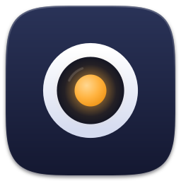
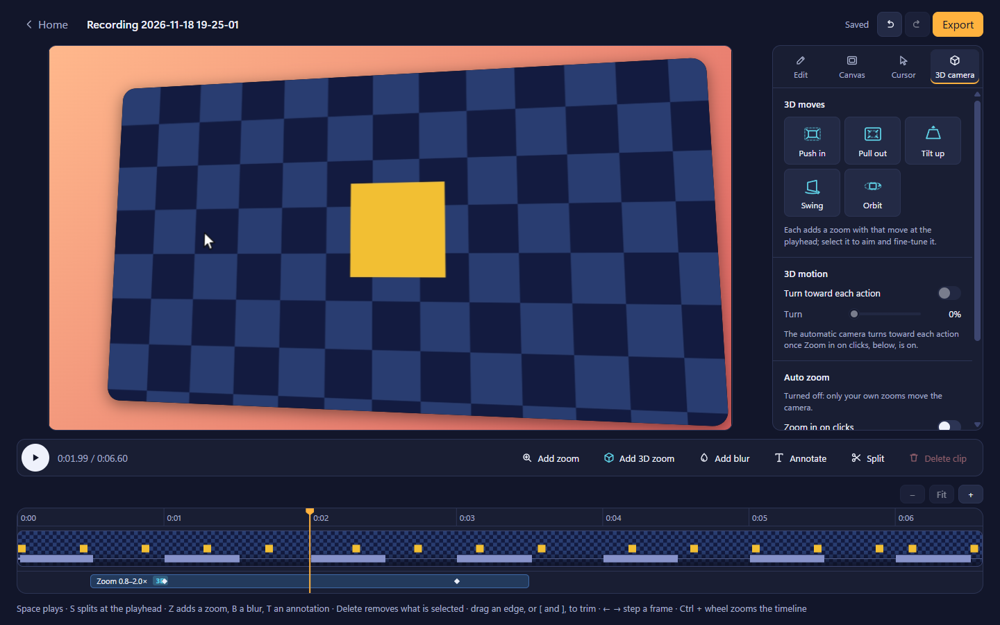
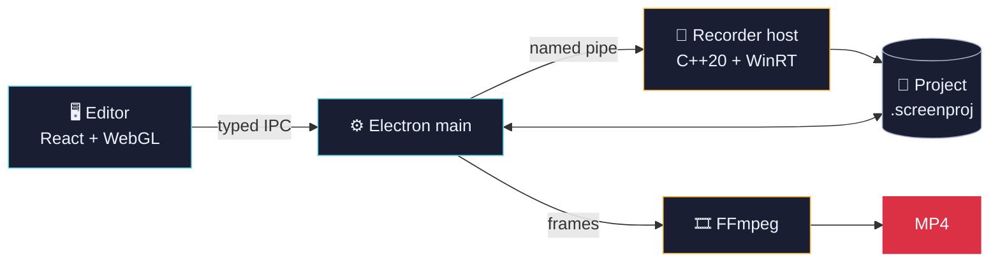

<div align="center">



# usee

**Free, open-source screen recorder and editor for Windows**

Record your screen and get a video that looks edited: usee zooms in where you click,<br>
smooths the cursor, moves the camera in 3D and sets the picture on a background.<br>
Built for developers who record demos, tutorials and bug reports.

[](https://github.com/techuhat/usee/actions/workflows/ci.yml)
[](https://github.com/techuhat/usee/releases/latest)
[](LICENSE)
[](#-build-and-run)
[](CONTRIBUTING.md)

</div>



## ⬇️ Download

<a href="https://apps.microsoft.com/detail/9n7gb8ld2g62?mode=direct"></a>

usee is in the [Microsoft Store](https://apps.microsoft.com/detail/9n7gb8ld2g62), for Windows 10 (version 2004 or later) and Windows 11, x64. The Store signs it, so it installs without a SmartScreen warning and keeps itself up to date.

You can also get the installer from the [latest release](https://github.com/techuhat/usee/releases/latest). It installs for your user alone, with no administrator rights. The website, [techuhat.github.io/usee](https://techuhat.github.io/usee/), shows what usee does.

> [!NOTE]
> The installer on GitHub is not signed yet, so Windows SmartScreen may warn the first time you run it: choose **More info**, then **Run anyway**. The [code signing policy](#-code-signing-policy) says how signed releases will be made.

## 🎬 What it does

<table>
  <tr>
    <td width="50%" valign="top">
      <b>🎥 Record</b><br>
      A whole screen, one window or an area you draw, at 30 or 60 fps, with your microphone. A three-second countdown starts it; stop from the tray or with <kbd>Ctrl</kbd>+<kbd>Shift</kbd>+<kbd>F10</kbd>.
    </td>
    <td width="50%" valign="top">
      <b>🔍 Auto zoom</b><br>
      Zooms in on clicks and where the pointer rests, then follows the pointer while zoomed. Add your own zooms and set their depth, position and timing.
    </td>
  </tr>
  <tr>
    <td valign="top">
      <b>🧊 3D camera</b><br>
      One switch turns the picture toward each action. Or pick a move (push in, pull out, tilt up, swing, orbit) and drag the picture to turn it your way.
    </td>
    <td valign="top">
      <b>🖱️ Smooth cursor</b><br>
      Smooth movement that stays on the real pointer, in the size and colour you choose, with a click effect (ripple, pulse, ring or bounce) and a spotlight.
    </td>
  </tr>
  <tr>
    <td valign="top">
      <b>🎨 Canvas</b><br>
      Solid or gradient backgrounds, or the recording itself blurred behind the picture. Padding, rounded corners, shadow, aspect ratios and motion blur.
    </td>
    <td valign="top">
      <b>✏️ Annotations</b><br>
      Words, arrows and boxes over the video, and blur for anything private, as a rectangle, an ellipse or a polygon.
    </td>
  </tr>
  <tr>
    <td valign="top">
      <b>✂️ Timeline</b><br>
      Split, trim, ripple-delete and change speed from 0.25× to 4×, with undo and redo. Each clip shows its frames and its waveform.
    </td>
    <td valign="top">
      <b>📦 Export</b><br>
      MP4 at 1080p30, 1080p60, 1440p30 or 4K30, encoded by Windows' own H.264 encoder, on the graphics card when it can.
    </td>
  </tr>
</table>

## 🔒 Private by design

Screen recordings show a lot, so usee keeps them with you.

- Recordings stay on your computer. There is no account, no cloud upload and no telemetry.
- The microphone is chosen for each recording and never remembered.
- usee records where the pointer moves and clicks, to draw the cursor. It never reads keystrokes.
- Window titles appear only in the window picker. Logs and project files name a window by an ID, and logs hide your user folder.

The [privacy policy](PRIVACY.md) has the details: what is kept, where, and how to remove it.

## 🧰 Build and run

| You need                  | Version                                    |
| ------------------------- | ------------------------------------------ |
| Windows                   | 10 (version 2004 or later) or 11, x64      |
| Node.js                   | 22.13 or newer, with npm 10 or newer       |
| Visual Studio Build Tools | 2019 16.11 or newer, with the C++ workload |
| Windows SDK               | 10.0.22000 or newer                        |

```powershell
git clone https://github.com/techuhat/usee.git
cd usee
npm install            # pinned dependencies and Electron
npm run build:native   # the C++ recorder host, with its tests
npm run dev            # starts usee in development mode
```

> [!IMPORTANT]
> Export needs an FFmpeg runtime built from FFmpeg's own source with MSYS2: `npm run build:ffmpeg -- --sources <dir> --msys2 <msys64>`. Without it, usee records and edits but does not export. [ADR-008](docs/decisions/ADR-008-ffmpeg-licensing.md) explains the build and why it is done this way.

`npm run package` builds an installer into `build/release/`. It is unsigned for now, and export stays off in it until a reviewed FFmpeg runtime is part of the build ([docs/release.md](docs/release.md)).

## 🗺️ Roadmap

Coming next, in this order: system audio, image backgrounds, more annotations (shapes, callouts, a magnifier, spotlights, motion), cursor styles and click sounds, per-clip volume and background music, GIF and more export sizes, and named presets.

Webcam, captions, noise reduction and anything that reads keystrokes each wait for a privacy and licence review first. [docs/roadmap.md](docs/roadmap.md) lists every feature and where it stands.

## 🧩 How it is built



The Electron app holds the interface, the editing and the export. Capture runs in its own C++ process, the recorder host, which uses Windows Graphics Capture, WASAPI and Media Foundation and talks to the app over an authenticated named pipe. To export, the editor composes every frame and the app hands it to FFmpeg. [docs/architecture.md](docs/architecture.md) has the full picture, and [docs/](docs) holds the specification and the decision records.

## 🤝 Contributing

Bug reports, ideas and pull requests are all welcome. [CONTRIBUTING.md](CONTRIBUTING.md) covers the setup, the checks to run and how the docs work as the specification. Features marked **Next** in the [roadmap](docs/roadmap.md) are good places to start. Questions and ideas go to [Discussions](https://github.com/techuhat/usee/discussions), and [GitHub Sponsors](https://github.com/sponsors/techuhat) keeps usee free and moving. Everyone taking part follows the [Code of Conduct](CODE_OF_CONDUCT.md).

## 🔏 Code signing policy

The Microsoft Store signs the usee it distributes. The installer on GitHub is not signed yet ([docs/release.md](docs/release.md#signing) says what signing waits for). Once it is, signing follows this policy:

- **Builds.** Every signed file is built by [`release.yml`](.github/workflows/release.yml) on GitHub Actions from this repository's public source, and each release is approved by hand before it is signed. Only usee's own files are signed: the installer, `usee.exe` and the recorder host. `ffmpeg.exe`, built from FFmpeg's official source by the same workflow, ships unsigned inside the signed installer.
- **Team roles.** Committers and reviewers: [techuhat](https://github.com/techuhat). Approvers, who approve every signing request: [techuhat](https://github.com/techuhat). Changes from anyone else are reviewed before they are merged.
- **Privacy.** This program will not transfer any information to other networked systems unless specifically requested by the user or the person installing or operating it ([privacy policy](PRIVACY.md)).

## 🛡️ Security

Found a vulnerability? Please report it privately, as [SECURITY.md](SECURITY.md) describes, not in a public issue.

## 📄 License

usee is free software under the [MIT License](LICENSE): anyone may use, change and share it, for any purpose.

usee exports with [FFmpeg](https://ffmpeg.org), licensed under the [LGPL 2.1](https://www.gnu.org/licenses/old-licenses/lgpl-2.1.html) or later and built from its official source ([ffmpeg-9.0.2.tar.xz](https://ffmpeg.org/releases/ffmpeg-9.0.2.tar.xz)) without GPL or non-free parts, as [ADR-008](docs/decisions/ADR-008-ffmpeg-licensing.md) records; each release carries that source beside its installer. The app also includes Electron and Chromium, and React, react-dom, scheduler, zustand and zod, under their own licences, which ship with it.
